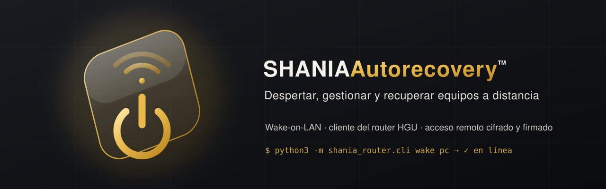

# Autorecovery



Encender, reiniciar y recuperar a distancia los equipos de una red doméstica o de oficina pequeña
(Mac, PC, portátiles), y dejarlos configurados para que una caída se resuelva sola. Incluye un cliente
del router HGU de O2/Movistar y un **acceso remoto cifrado y firmado** para gestionarlo desde fuera.

Proyecto de código abierto de **Shania Webstudio**, bajo licencia Apache-2.0. Sin claves en el código.

## Por qué existe

Nació de un problema real. Una máquina de trabajo amaneció **apagada tras un corte de luz**, sin nadie
en casa para encenderla y con el trabajo parado. Encenderla por red (Wake-on-LAN) debería haber sido
trivial, pero no lo era: **no teníamos a mano su dirección MAC**, la administración del router estaba
protegida y, aunque la hubiéramos sabido, **el equipo no estaba preparado** para despertar (inicio
rápido de Windows activo, WoL sin confirmar en la BIOS). Y, sobre todo, no había forma **segura** de
hacer nada de esto **desde fuera de casa**.

Los proyectos de la comunidad resolvían piezas sueltas —listar los dispositivos del router, reiniciarlo,
rastrear presencia—, pero ninguno cubría la necesidad entera: **despertar cualquier equipo, recuperar su
sesión y poder hacerlo de forma cifrada desde cualquier sitio** sin exponer el router a internet.

Así que juntamos todo en una sola herramienta:

- **Despertar por LAN** cualquier equipo, con verificación por ping.
- **Leer el router** para encontrar la MAC/IP de un equipo cuando no la tienes (o rescatarla de registros).
- **Dejar cada equipo configurado** (WoL en la tarjeta, inicio rápido desactivado, arranque automático)
  para que el despertar funcione de verdad y una caída se resuelva sola.
- **Acceso remoto cifrado y firmado**: un agente dentro de casa recibe órdenes por una pasarela cifrada
  (Tailscale/WireGuard) y actúa en la LAN; **la contraseña del router nunca sale de casa**.

El principio de diseño es sencillo: lo sensible se queda en casa, cada orden remota va firmada, y nada
irreversible ocurre sin confirmación. De un apagón que paró el trabajo salió la herramienta para que no
vuelva a pasar.

## Qué hay
- **`shania_router/`** — librería Python, sin dependencias externas:
  - `hgu.py` — cliente del router HGU (`te_*.asp`, login con ofuscación XOR 0x1f), listado de dispositivos y MAC por IP.
  - `cli.py` — `wake` / `mac` / `devices`: resuelve la MAC (tabla local, ARP vivo, router) y despierta con comprobación por ping.
  - `agent.py` — **agente en casa**: recibe órdenes firmadas (HMAC-SHA256) y las ejecuta en la LAN.
  - `remote.py` — **cliente remoto**: firma las órdenes y llama al agente por la pasarela cifrada.
- **`scripts/`** — `despertar.py` (Wake-on-LAN), `configurar-wol.ps1` (Windows, idempotente),
  `buscar-mac-en-logs.sh` (rescata una MAC desde tablas ARP ya registradas), `bios-checklist.md`,
  `procedimiento-emergencia.md`.
- **`docs/`** — `ACCESO-REMOTO.md` (pasarela cifrada), `ANALISIS-GITHUB.md` (proyectos de la comunidad), `macs.example.txt`.
- **`SKILL.md`** y **`.claude-plugin/`** — skill y plugin para Claude Code.

## Requisitos
- **Python 3.9+**, sin dependencias externas (solo biblioteca estándar).
- Para el WoL: tarjeta de red con Wake-on-LAN (mejor por **cable**) y BIOS preparada.
- Para el acceso remoto: [Tailscale](https://tailscale.com) (gratis para uso personal).
- Para configurar Windows: **PowerShell 5.1+** (el que trae Windows) como administrador.
- Probado contra el router **HGU de O2/Movistar** (firmware Telefónica, páginas `te_*.asp`,
  fabricante Askey o MitraStar). Otros firmwares pueden requerir ajustar `shania_router/hgu.py`.

## Instalación como plugin/skill de Claude Code
```
/plugin marketplace add LV-webstudio/autorecovery
/plugin install autorecovery
```
O clónalo y usa los scripts directamente (no hace falta instalar nada):
```bash
git clone https://github.com/LV-webstudio/autorecovery
```

## Configuración de la tabla de MAC
Copia `docs/macs.example.txt` a `~/.config/autorecovery/macs.txt` y pon tus equipos
(`nombre MAC (IP) · notas`, una línea por equipo). Ese fichero no se sube nunca al repositorio.

## Uso rápido
```bash
# en la LAN:
python3 scripts/despertar.py pc
python3 -m shania_router.cli wake pc
python3 -m shania_router.cli mac 192.168.1.20

# desde fuera (por la pasarela cifrada de Tailscale):
export SHANIA_AGENT_URL=https://mi-equipo.mi-tailnet.ts.net SHANIA_AGENT_TOKEN=...
python3 -m shania_router.remote wake pc
```

## Seguridad
- La contraseña del router (la de la pegatina, no la del Wi-Fi) vive solo en el agente local
  (`SHANIA_ROUTER_PW`) y no viaja. Los secretos van por entorno o llavero, nunca en git.
- El router no se expone a internet. El agente va cifrado (pasarela) y firmado (HMAC con ventana anti-repetición).
- Las acciones que cortan la red (reinicio del router) exigen confirmación explícita.

## Estado
- Wake-on-LAN por LAN: operativo (emisor y agente probados de extremo a extremo).
- Cliente del router: login funcional; el parseo de la tabla de dispositivos y el endpoint de reinicio
  pueden variar según el firmware y conviene confirmarlos en la primera ejecución.
- Scripts de Windows y BIOS: listos para aplicar en cada equipo.

## Licencia
Apache-2.0. Ver `LICENSE` y `NOTICE.md`.
